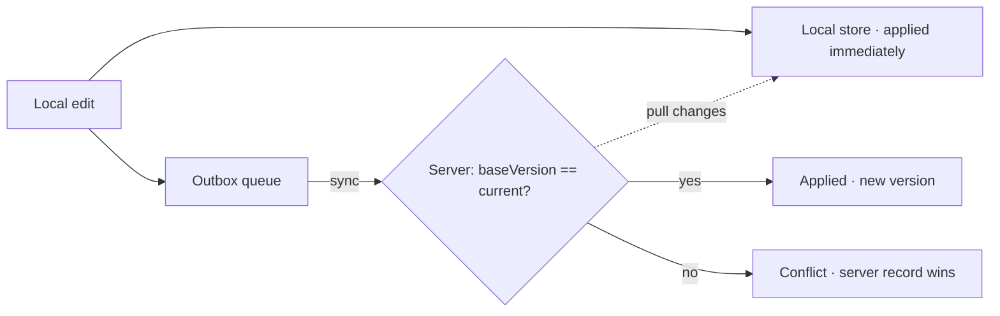

# offline-sync — an offline-first sync engine

> A TypeScript sync engine for offline-first apps. Local edits apply immediately
> and queue in an **outbox**; on sync they push to the server under **optimistic
> concurrency**. When the server has newer data, the stale local change is
> **rejected and the server's record wins** — never a silent overwrite of newer
> data.


> ℹ️ An **original reference implementation**. No proprietary code or data.

---

## The problem

Offline-first clients must stay usable with no network, then reconcile when they
reconnect — without clobbering changes other clients made in the meantime. The
naive "last write wins" loses data. This engine instead does **optimistic
concurrency with explicit conflict rejection**.



- **Outbox** — pending mutations, coalesced to one op per record (latest value)
  while preserving the *original* baseVersion, so a burst of offline edits still
  checks against the last synced version.
- **Optimistic concurrency** — each push carries the `baseVersion` the client
  last saw. The server applies it only if that still matches; otherwise it's a
  conflict.
- **Conflict = server wins** — a stale local update is dropped (not retried
  blindly, not overwriting newer server data) and the server's record is adopted
  locally, surfaced in the sync report.
- **Pull** — server changes merge into records the client isn't actively editing.

---

## Use it

```ts
import { InMemoryServer } from "./src/server.js";
import { SyncEngine } from "./src/engine.js";

const engine = new SyncEngine(new InMemoryServer());
engine.put("note-1", { text: "Buy milk" });   // offline, queued
const report = engine.sync();                  // { pushed, conflicts, pulled }
```

```bash
npm install
npm run demo        # two clients, a sync, a pull, and a conflict
npm run typecheck   # tsc --noEmit
npm test            # vitest
```

## Tests

The suite covers the outbox (coalescing + baseVersion preservation), the
server's optimistic-concurrency accept/reject and pull cursor, and the engine
end to end: offline queuing, push, cross-client pull, **conflict rejection
(server wins, stale op dropped)**, repeated edit→sync version advancement, and
delete tombstones.

---

## Design decisions

- **`ServerPort` is an interface** — an in-memory server drives the tests; a real
  HTTP client implements the same `push`/`pull` in production.
- **Global increasing versions** double as the pull cursor, so a client pulls
  exactly what it hasn't seen.
- **Reject, don't merge** — conflict resolution here is "server wins" by design;
  the seam is explicit, so a field-level merge policy could slot in later.

---

*An original reference implementation. No proprietary code or data is included.*
